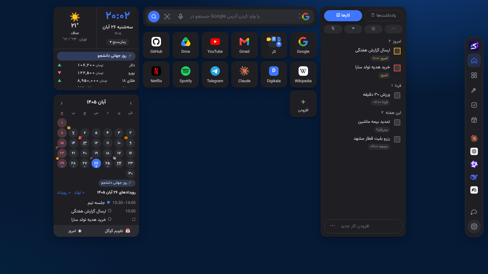
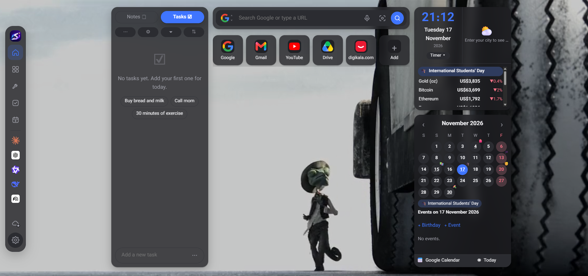
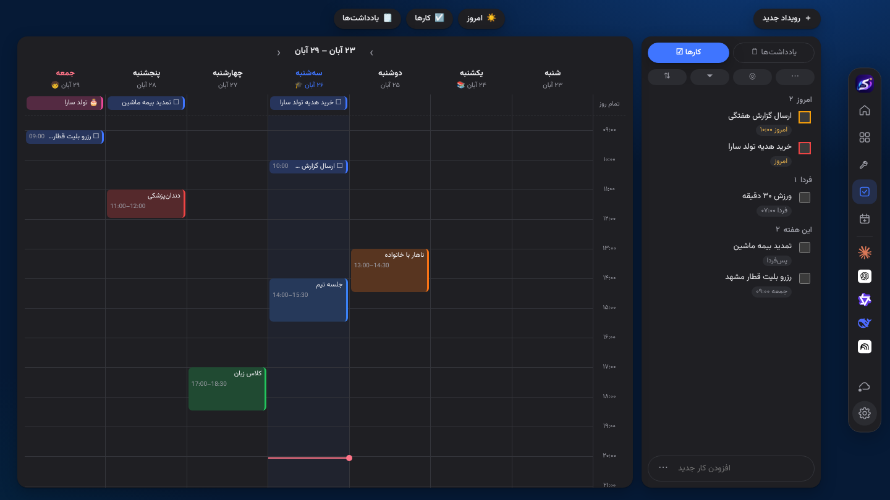
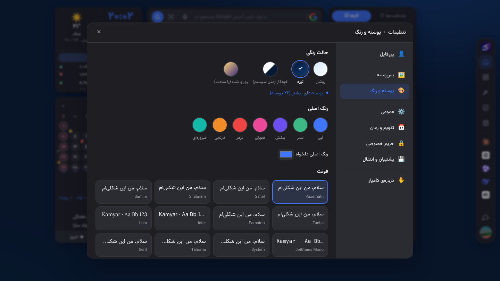
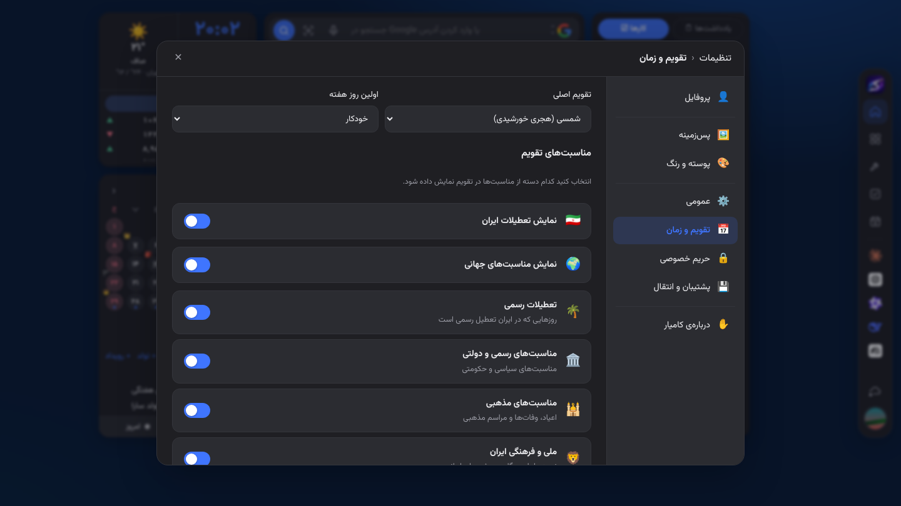
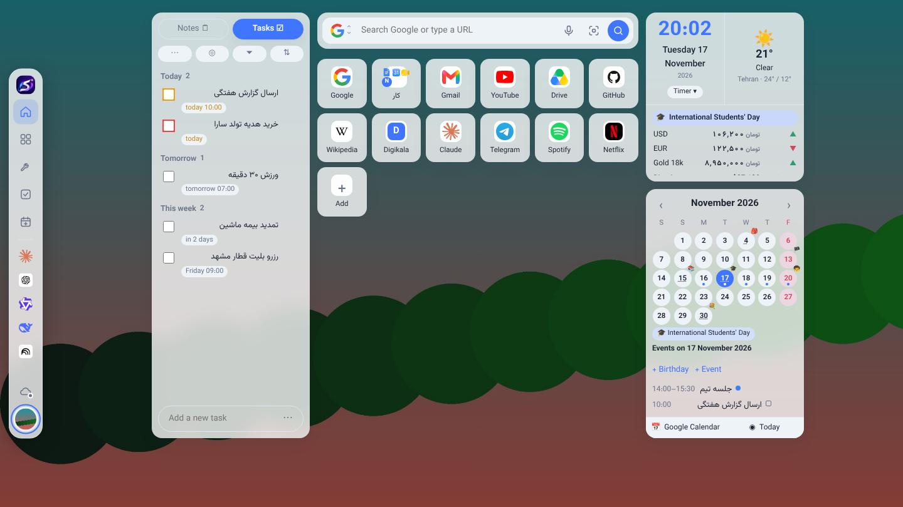

<p align="center"></p>

<h1 align="center">Kamyar · کامیار</h1>

<p align="center"><b>کامیار | یار هوشمند شما</b><br/><i>Kamyar | Your smart companion</i></p>

<p align="center">
  
  
  
  
  
</p>

<h2 align="center"><a href="https://github.com/M-Mashreghi/Kamyar/releases/latest">⬇️ دانلود آخرین نسخه · Download the latest release</a></h2>

<p align="center"><b><a href="#-نصب">📥 راهنمای نصب</a> · <a href="#-انتقال-اطلاعات-از-افزونه‌ی-دستیار">🔄 انتقال از دستیار</a> · <a href="#-install">📥 Install guide</a> · <a href="#-move-your-data-from-dastyar">🔄 Move from Dastyar</a></b></p>

<p align="center"><a href="#فارسی">فارسی</a> · <a href="#english">English</a></p>

<p align="center"></p>

---

<div dir="rtl">

## فارسی

کامیار یک **تب جدید شخصی** برای گوگل کروم است. هر بار که تب جدید باز می‌کنید، تقویم، کارهای امروز، یادداشت‌ها، میان‌برها، آب‌وهوا و نرخ ارز جلوی چشمتان است. کامیار **هیچ تبلیغ و هیچ ردیابی ندارد** و اطلاعاتتان فقط در مرورگر و **حساب گوگل خودتان** ذخیره می‌شود.

### صفحه‌ی اصلی

همه‌چیز در یک صفحه، بدون اسکرول: ساعت و تاریخ، آب‌وهوا، مناسبت امروز، نرخ ارز و طلا، تقویم ماه، جستجو و میان‌برها، و پنل کارها و یادداشت‌ها.

<p align="center"></p>

کامیار در استفاده‌ی واقعی، با عکس پس‌زمینه‌ی دلخواه و نرخ‌های زنده:

<p align="center"></p>

### تقویم و مناسبت‌ها

- سه تقویم **شمسی، میلادی و قمری** که با هم نشان داده می‌شوند.
- **مناسبت‌های ایرانی و جهانی**، هر کدام با ایموجی خودش، روی تقویم و به‌صورت «مناسبت امروز» بالای صفحه.
- تعطیلات رسمی ایران، و روزهای متغیر مثل چهارشنبه‌سوری، عید پاک، روز مادر و روز پدر.
- ۱۲ دسته‌ی مناسبت (مذهبی، ملی، هنر، علم، ورزش، فناوری و …) که هر کدام جدا روشن یا خاموش می‌شوند.
- رویداد، تولد و یادآوری، با تکرار روزانه، هفتگی، ماهانه و سالانه.
- نمایش رویدادهای **تقویم گوگل** (اختیاری).

### برنامه‌ی هفتگی

با دکمه‌ی «کارها و یادداشت‌ها» در نوار کناری، برنامه‌ی هفته ساعت‌به‌ساعت باز می‌شود. رویدادها، کارهای ساعت‌دار و تولدها کنار هم دیده می‌شوند. با کلیک روی یک ساعت خالی، رویداد جدید در همان ساعت ساخته می‌شود.

<p align="center"></p>

### کارها و یادداشت‌ها

- کار با تاریخ، ساعت، اولویت، برچسب، یادآوری و تکرار.
- بوردهای جدا (مثلاً «کار» و «خانه»)، فیلتر و مرتب‌سازی، و صفحه‌ی کامل کارها.
- یادداشت‌های سریع با جستجو.

### میان‌برها و سرویس‌ها

- میان‌برها با **لوگوی واقعی هر سایت**، پوشه، کشیدن و جابه‌جا کردن، و منوی راست‌کلیک.
- صفحه‌ی سرویس‌ها با دسته‌بندی: **هوش مصنوعی** (Claude، ChatGPT، Gemini، DeepSeek، Qwen، NotebookLM و …)، **همه‌ی سرویس‌های گوگل**، سایت‌های ایرانی، خرید، سفر، فیلم، موسیقی، شبکه‌های اجتماعی، خبر، **خبرگزاری‌های آمریکا** (رویترز، AP، CNN، نیویورک تایمز و …)، **گیمینگ** (Steam، Epic، PlayStation، IGN و …)، **والپیپر** (Wallhaven، Wallpaper Abyss، Wallpaper Cave و …) و ابزار.
- دسترسی سریع به Claude، ChatGPT، Gemini، Qwen، DeepSeek و NotebookLM از نوار کناری.

<p align="center"></p>

### ابزارها

آب‌وهوا، اوقات شرعی، نرخ ارز و طلا، پومودورو، تایمر، کرنومتر، شمارش معکوس، تبدیل تاریخ و محاسبه‌ی سن. جستجو با صدا و با عکس هم داخل خود صفحه است.

### تنظیمات

<table>
<tr>
<td></td>
<td></td>
</tr>
<tr>
<td></td>
<td></td>
</tr>
</table>

- **پروفایل:** عکس پروفایل، نام، نام کاربری و تاریخ تولد. ورود و خروج با حساب گوگل از طریق کروم.
- **پوسته و رنگ:** روشن، تیره، خودکار، روز و شب، به‌علاوه‌ی ۲۶ پوسته‌ی دیگر و ۷ رنگ اصلی یا رنگ دلخواه.
- **۱۳ فونت:** وزیرمتن، ساحل، شبنم، صمیم، تنها، پرستو، Inter، Lora، JetBrains Mono و … همه داخل افزونه، بدون نیاز به اینترنت.
- **پس‌زمینه:** عکس از کامپیوتر (با عوض شدن خودکار) یا **ویدیو** (MP4 یا WebM).
- **چهار زبان:** فارسی، English، Français، Deutsch.
- پشتیبان‌گیری، بازگردانی، و **انتقال اطلاعات از افزونه‌ی دستیار**.

### اطلاعات شما کجا ذخیره می‌شود؟

| چه چیزی | کجا |
|---|---|
| کارها، یادداشت‌ها، رویدادها، میان‌برها، تنظیمات، عکس پروفایل | **حساب گوگل خودتان** (همگام‌سازی کروم)، روی همه‌ی دستگاه‌ها |
| عکس و ویدیوی پس‌زمینه | فقط همین دستگاه |
| گوگل درایو (اختیاری) | پوشه‌ی مخفی افزونه در درایو خودتان، برای فضای بیشتر |

هیچ سروری وجود ندارد و هیچ اطلاعاتی برای ما فرستاده نمی‌شود.

## 📥 نصب

> ⚠️ **کامیار هنوز در فروشگاه کروم (Chrome Web Store) نیست، برای همین دستی نصب می‌شود. فقط چند دقیقه طول می‌کشد.**

1. **دانلود: به صفحه‌ی [Releases](https://github.com/M-Mashreghi/Kamyar/releases/latest) بروید و فایل `Kamyar-v….zip` را دانلود کنید.**
2. **باز کردن فایل: روی فایل zip راست‌کلیک کنید و Extract All را بزنید (در مک: دوبار کلیک). پوشه‌ی `Kamyar` را جایی بگذارید که پاکش نکنید (مثلاً Documents)، چون کروم افزونه را از همین پوشه اجرا می‌کند.**
3. **صفحه‌ی افزونه‌ها: در نوار آدرس کروم بنویسید `chrome://extensions` و Enter بزنید.**
4. **حالت توسعه‌دهنده: کلید Developer mode را در گوشه‌ی بالا سمت راست روشن کنید.**
5. **نصب: دکمه‌ی Load unpacked را بزنید و پوشه‌ی `Kamyar` را انتخاب کنید (همان پوشه‌ای که فایل `manifest.json` داخلش است).**
6. **تب جدید: یک تب جدید باز کنید. اگر کروم پرسید «این تغییر را نگه می‌دارید؟»، گزینه‌ی Keep it را بزنید.**
7. **ذخیره در حساب گوگل: در کروم با حساب گوگلتان وارد شوید و همگام‌سازی را روشن کنید (روی عکس پروفایل کروم بزنید ← Turn on sync) تا اطلاعاتتان روی همه‌ی دستگاه‌ها باشد.**

> 💡 **به‌روزرسانی: نسخه‌ی جدید را دانلود کنید، محتوای پوشه‌ی قبلی `Kamyar` را با آن جایگزین کنید و در `chrome://extensions` روی دکمه‌ی 🔄 (Reload) افزونه بزنید. اطلاعاتتان پاک نمی‌شود.**

**راهنمای کامل‌تر، از جمله وصل کردن گوگل درایو و تقویم گوگل، در [SETUP.md](SETUP.md) است.**

## 🔄 انتقال اطلاعات از افزونه‌ی دستیار

> ℹ️ **اگر قبلاً افزونه‌ی دستیار را داشتید، می‌توانید کارها، بوردها، برچسب‌ها، یادداشت‌ها، میان‌برها و تولدهایتان را به کامیار بیاورید. کروم اجازه نمی‌دهد یک افزونه اطلاعات افزونه‌ی دیگر را مستقیم بخواند، برای همین این کار یک‌بار و با یک کد کوتاه انجام می‌شود (حدود ۲ دقیقه).**

1. **گرفتن کد: در کامیار تنظیمات (⚙️) ← پشتیبان و انتقال ← انتقال اطلاعات… را بزنید، بعد کپی کد را بزنید. این پنجره را نبندید.**
2. **باز کردن دستیار: در `chrome://extensions` کامیار را موقتاً خاموش کنید (دستیار باید روشن باشد) و یک تب جدید باز کنید تا صفحه‌ی دستیار بیاید. چند ثانیه صبر کنید تا کارها و یادداشت‌هایتان کامل نشان داده شود.**
3. **اجرای کد: روی صفحه‌ی دستیار راست‌کلیک کنید ← Inspect ← زبانه‌ی Console. کد را جای‌گذاری کنید (Ctrl+V) و Enter بزنید. اگر کروم اجازه‌ی جای‌گذاری نداد، اول عبارت `allow pasting` را تایپ کنید و Enter بزنید. فایل `dastyar-export.json` دانلود می‌شود.**
4. **وارد کردن در کامیار: کامیار را دوباره روشن کنید، به همان پنجره‌ی «انتقال از دستیار» برگردید و فایل دانلودشده را انتخاب کنید.**
5. **تمام: پیامی نشان می‌دهد چند کار، یادداشت و میان‌بر منتقل شد. بعد از آن اگر خواستید، دستیار را حذف کنید.**

**چند نکته:**
- **تاریخ‌های شمسی خودکار تبدیل می‌شوند. اگر دوباره انتقال بدهید، موارد تکراری اضافه نمی‌شوند.**
- **تولدها به‌صورت کار سالانه منتقل می‌شوند و پوشه‌های میان‌بر باز می‌شوند.**
- **رمز، توکن و اطلاعات ورود حساب دستیار در فایل نمی‌آید.**
- **اگر اطلاعاتی فقط روی سرور دستیار باشد و در صفحه بارگذاری نشده باشد، منتقل نمی‌شود. برای همین قبل از اجرای کد صبر کنید تا صفحه کامل بالا بیاید.**

### میان‌برهای کیبورد

| کلید | کار |
|---|---|
| <kbd>/</kbd> | رفتن به جستجو |
| <kbd>t</kbd> | کار جدید |
| <kbd>k</kbd> | صفحه‌ی کارها |
| <kbd>n</kbd> | یادداشت جدید |
| <kbd>e</kbd> | رویداد جدید |
| <kbd>b</kbd> | میان‌بر جدید |
| <kbd>v</kbd> | جستجوی صوتی |
| <kbd>i</kbd> | جستجو با عکس |
| <kbd>,</kbd> | تنظیمات |
| <kbd>?</kbd> | راهنمای میان‌برها |

</div>

---

## English

Kamyar is a **personal new-tab page for Google Chrome**. Every new tab shows your calendar, today's tasks, notes, shortcuts, weather and exchange rates on one screen. It has **no ads and no tracking**, and your data stays in your browser and your **own Google account**.

<p align="center"></p>

### Features

- **Calendar:** Persian (Solar Hijri), Gregorian and Islamic calendars side by side, with Iranian and international occasions, each with its own emoji. Twelve occasion categories that you can turn on or off one by one. Events, birthdays and reminders, with repeats. Optional Google Calendar events.
- **Weekly planner:** an hour-by-hour week view of events, timed tasks and birthdays. Click an empty slot to add an event at that time.
- **Tasks and notes:** due dates, times, priorities, labels, reminders, repeats, boards, filters and sorting, plus quick notes with search.
- **Shortcuts and services:** shortcuts with real site logos, folders, drag and drop, and a right-click menu. A services page with AI tools (Claude, ChatGPT, Gemini, DeepSeek, Qwen, NotebookLM…), every Google service, US news (Reuters, AP, CNN, NYT…), gaming (Steam, Epic, PlayStation, IGN…), wallpaper sites (Wallhaven, Wallpaper Abyss, Wallpaper Cave…), and popular Iranian and international sites.
- **Tools:** weather, prayer times, currency and gold rates, Pomodoro, timer, stopwatch, countdowns, date converter and age calculator. Voice and image search.
- **Look and feel:** light, dark, auto and day/night modes, 26 more themes, 7 accent colors or your own, **13 bundled fonts**, and image or **video** backgrounds.
- **Profile:** picture, name, username and birthday, saved to your Google account through Chrome Sync.
- **Four languages:** Persian, English, French and German.
- Backup and restore, and import from the Dastyar extension.

<p align="center"></p>

### Where your data lives

| What | Where |
|---|---|
| Tasks, notes, events, shortcuts, settings, profile picture | **Your own Google account** via Chrome Sync, on all your devices |
| Background images and video | This device only |
| Google Drive (optional) | A hidden app folder in your own Drive, for more space |

There is no server, and nothing is sent to us.

## 📥 Install

> [!IMPORTANT]
> **Kamyar is not on the Chrome Web Store yet, so you install it by hand. It takes a few minutes.**

1. **Download: go to [Releases](https://github.com/M-Mashreghi/Kamyar/releases/latest) and download `Kamyar-v….zip`.**
2. **Unzip: right-click the zip and choose Extract All (on a Mac, double-click it). Keep the `Kamyar` folder somewhere you won't delete, such as Documents, because Chrome runs the extension from it.**
3. **Open extensions: type `chrome://extensions` in the address bar and press Enter.**
4. **Developer mode: turn on the Developer mode switch in the top-right corner.**
5. **Install: click Load unpacked and choose the `Kamyar` folder (the one that contains `manifest.json`).**
6. **New tab: open a new tab. If Chrome asks whether to keep the change, click Keep it.**
7. **Save to your Google account: sign in to Chrome and turn on sync (click your Chrome profile picture → Turn on sync) so your data follows you to every device.**

> [!TIP]
> **Updating: download the new release, replace the contents of your `Kamyar` folder, and click 🔄 (Reload) on Kamyar in `chrome://extensions`. Your data stays.**

## 🔄 Move your data from Dastyar

> [!NOTE]
> **If you used the Dastyar extension, you can bring your tasks, boards, labels, notes, shortcuts and birthdays into Kamyar. Chrome doesn't let one extension read another's data, so you run a short snippet once (about two minutes).**

1. **Copy the snippet: in Kamyar open Settings (⚙️) → Backup & import → Move my data…, then click Copy code. Keep this window open.**
2. **Open Dastyar: in `chrome://extensions`, turn Kamyar off for a moment (keep Dastyar on) and open a new tab so Dastyar's page shows. Wait a few seconds until your tasks and notes have loaded.**
3. **Run the snippet: right-click Dastyar's page → Inspect → Console tab. Paste the snippet and press Enter. If Chrome blocks pasting, type `allow pasting`, press Enter, and paste again. A file named `dastyar-export.json` downloads.**
4. **Import into Kamyar: turn Kamyar back on, return to the "Move from Dastyar" window, and choose the downloaded file.**
5. **Done: Kamyar tells you how many tasks, notes and shortcuts it moved. You can remove Dastyar afterwards if you like.**

**Persian dates are converted automatically, and running the import again doesn't create duplicates. The file never includes Dastyar's passwords, tokens or sign-in data.**

### Project structure

```
manifest.json      Chrome MV3 manifest
newtab.html        The new-tab page
css/               Styles and bundled @font-face rules
js/                One file per feature (calendar, occasions, todos, planner, services, settings, …)
fonts/             Bundled fonts (SIL Open Font License)
icons/             App icons, logo and brand logos for shortcuts
docs/screenshots/  Images used in this README
```

### Credits

Fonts are under the SIL Open Font License (see `fonts/README.txt`). Brand logos come from CC0 and MIT icon sets and are listed in `icons/brands/NOTICE.txt`. Each logo belongs to its owner.
