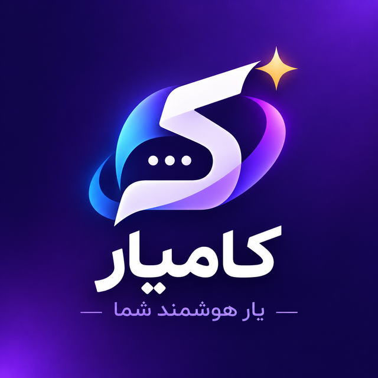
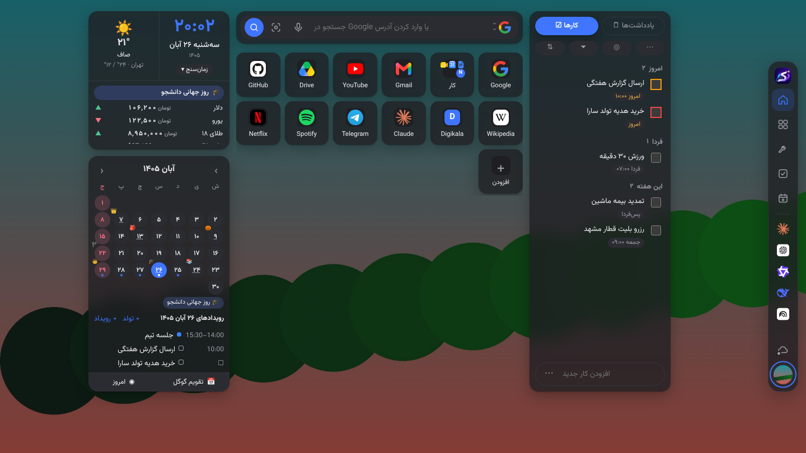
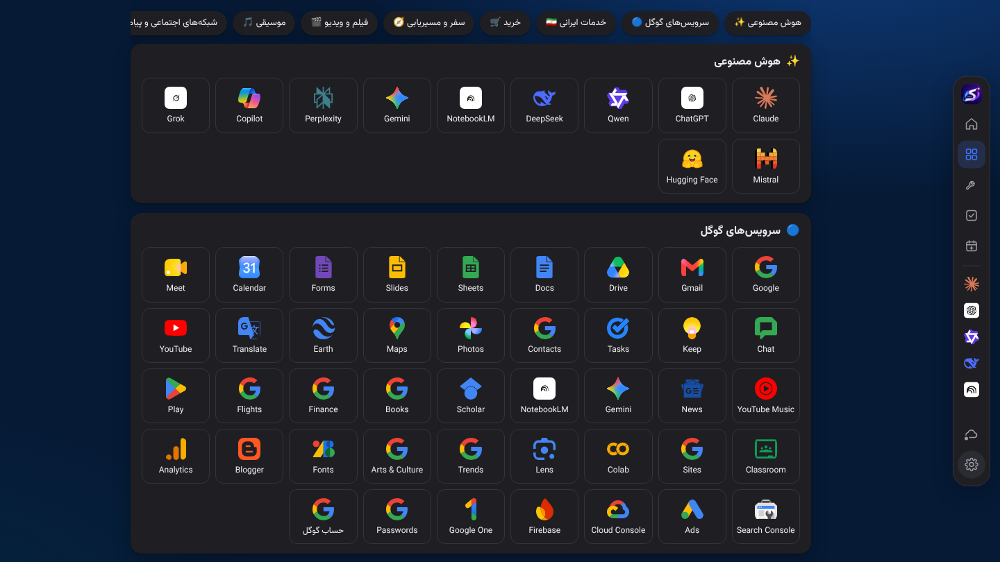
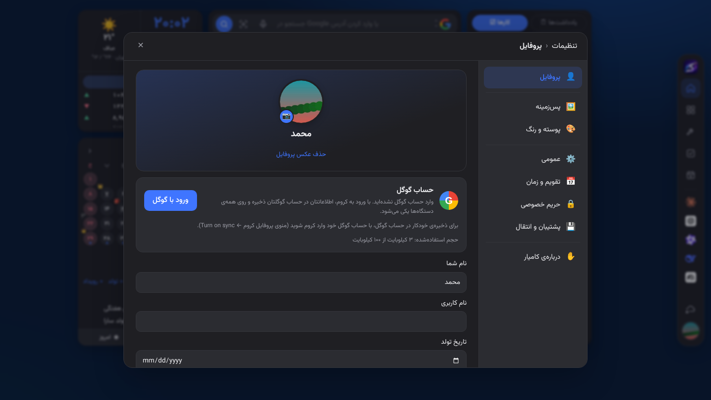
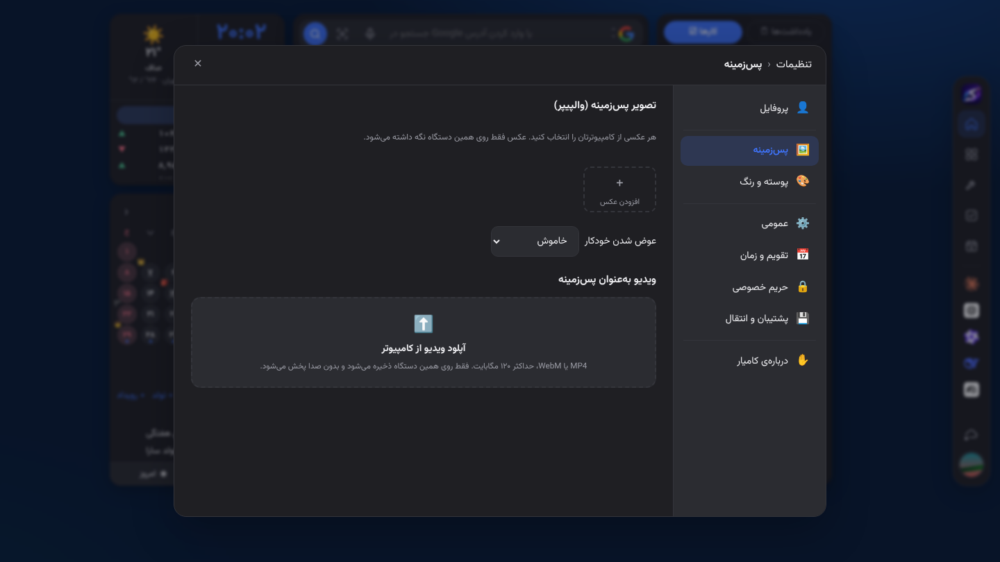
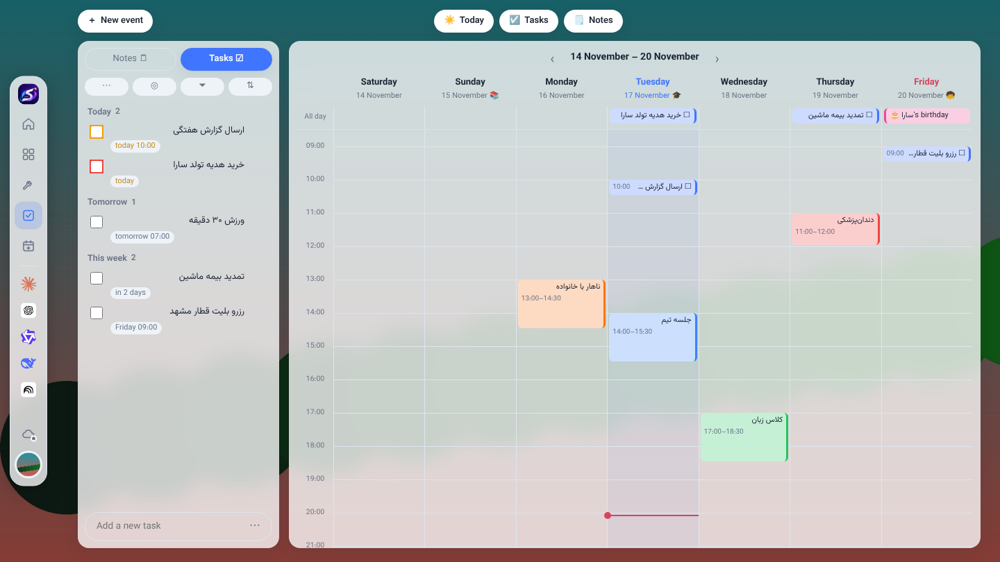

<p align="center"></p>

<h1 align="center">Kamyar · کامیار</h1>

<p align="center"><b>کامیار | یار هوشمند شما</b><br/><i>Kamyar | Your smart companion</i></p>

<p align="center">
  
  
  
  
  
</p>

<p align="center"><a href="#فارسی">فارسی</a> · <a href="#english">English</a></p>

<p align="center"></p>

---

<div dir="rtl">

## فارسی

کامیار یک **تب جدید شخصی** برای گوگل کروم است. هر بار که تب جدید باز می‌کنید، تقویم، کارهای امروز، یادداشت‌ها، میان‌برها، آب‌وهوا و نرخ ارز جلوی چشمتان است. کامیار **هیچ تبلیغ و هیچ ردیابی ندارد** و اطلاعاتتان فقط در مرورگر و **حساب گوگل خودتان** ذخیره می‌شود.

### صفحه‌ی اصلی

همه‌چیز در یک صفحه، بدون اسکرول: ساعت و تاریخ، آب‌وهوا، مناسبت امروز، نرخ ارز و طلا، تقویم ماه، جستجو و میان‌برها، و پنل کارها و یادداشت‌ها.

<p align="center"></p>

### تقویم و مناسبت‌ها

- سه تقویم **شمسی، میلادی و قمری** که با هم نشان داده می‌شوند.
- **مناسبت‌های ایرانی و جهانی**، هر کدام با ایموجی خودش، روی تقویم و به‌صورت «مناسبت امروز» بالای صفحه.
- تعطیلات رسمی ایران، و روزهای متغیر مثل چهارشنبه‌سوری، عید پاک، روز مادر و روز پدر.
- ۱۲ دسته‌ی مناسبت (مذهبی، ملی، هنر، علم، ورزش، فناوری و …) که هر کدام جدا روشن یا خاموش می‌شوند.
- رویداد، تولد و یادآوری، با تکرار روزانه، هفتگی، ماهانه و سالانه.
- نمایش رویدادهای **تقویم گوگل** (اختیاری).

### برنامه‌ی هفتگی

با دکمه‌ی «کارها و یادداشت‌ها» در نوار کناری، برنامه‌ی هفته ساعت‌به‌ساعت باز می‌شود. رویدادها، کارهای ساعت‌دار و تولدها کنار هم دیده می‌شوند. با کلیک روی یک ساعت خالی، رویداد جدید در همان ساعت ساخته می‌شود.

<p align="center"></p>

### کارها و یادداشت‌ها

- کار با تاریخ، ساعت، اولویت، برچسب، یادآوری و تکرار.
- بوردهای جدا (مثلاً «کار» و «خانه»)، فیلتر و مرتب‌سازی، و صفحه‌ی کامل کارها.
- یادداشت‌های سریع با جستجو.

### میان‌برها و سرویس‌ها

- میان‌برها با **لوگوی واقعی هر سایت**، پوشه، کشیدن و جابه‌جا کردن، و منوی راست‌کلیک.
- صفحه‌ی سرویس‌ها با دسته‌بندی: **هوش مصنوعی** (Claude، ChatGPT، Gemini، DeepSeek، Qwen، NotebookLM و …)، **همه‌ی سرویس‌های گوگل**، سایت‌های ایرانی، خرید، سفر، فیلم، موسیقی، شبکه‌های اجتماعی، خبر و ابزار.
- دسترسی سریع به Claude، ChatGPT، Qwen، DeepSeek و NotebookLM از نوار کناری.

<p align="center"></p>

### ابزارها

آب‌وهوا، اوقات شرعی، نرخ ارز و طلا، پومودورو، تایمر، کرنومتر، شمارش معکوس، تبدیل تاریخ و محاسبه‌ی سن. جستجو با صدا و با عکس هم داخل خود صفحه است.

### تنظیمات

<table>
<tr>
<td></td>
<td></td>
</tr>
<tr>
<td></td>
<td></td>
</tr>
</table>

- **پروفایل:** عکس پروفایل، نام، نام کاربری و تاریخ تولد. ورود و خروج با حساب گوگل از طریق کروم.
- **پوسته و رنگ:** روشن، تیره، خودکار، روز و شب، به‌علاوه‌ی ۲۶ پوسته‌ی دیگر و ۷ رنگ اصلی یا رنگ دلخواه.
- **۱۳ فونت:** وزیرمتن، ساحل، شبنم، صمیم، تنها، پرستو، Inter، Lora، JetBrains Mono و … همه داخل افزونه، بدون نیاز به اینترنت.
- **پس‌زمینه:** عکس از کامپیوتر (با عوض شدن خودکار) یا **ویدیو** (MP4 یا WebM).
- **چهار زبان:** فارسی، English، Français، Deutsch.
- پشتیبان‌گیری، بازگردانی، و **انتقال اطلاعات از افزونه‌ی دستیار**.

### اطلاعات شما کجا ذخیره می‌شود؟

| چه چیزی | کجا |
|---|---|
| کارها، یادداشت‌ها، رویدادها، میان‌برها، تنظیمات، عکس پروفایل | **حساب گوگل خودتان** (همگام‌سازی کروم)، روی همه‌ی دستگاه‌ها |
| عکس و ویدیوی پس‌زمینه | فقط همین دستگاه |
| گوگل درایو (اختیاری) | پوشه‌ی مخفی افزونه در درایو خودتان، برای فضای بیشتر |

هیچ سروری وجود ندارد و هیچ اطلاعاتی برای ما فرستاده نمی‌شود.

### نصب

1. در کروم با حساب گوگلتان وارد شوید و همگام‌سازی را روشن کنید (منوی پروفایل کروم ← Turn on sync).
2. این مخزن را دانلود کنید (**Code ← Download ZIP**) و از حالت فشرده خارج کنید، یا با `git clone` بگیرید.
3. به `chrome://extensions` بروید و **Developer mode** را روشن کنید.
4. **Load unpacked** را بزنید و همین پوشه را انتخاب کنید.
5. یک تب جدید باز کنید. تمام!

برای به‌روزرسانی، پوشه‌ی جدید را جایگزین کنید و در `chrome://extensions` دکمه‌ی Reload را بزنید. اطلاعاتتان سر جایش می‌ماند.

راهنمای کامل‌تر، از جمله وصل کردن گوگل درایو و تقویم گوگل، در [SETUP.md](SETUP.md) است.

### میان‌برهای کیبورد

| کلید | کار |
|---|---|
| <kbd>/</kbd> | رفتن به جستجو |
| <kbd>t</kbd> | کار جدید |
| <kbd>k</kbd> | صفحه‌ی کارها |
| <kbd>n</kbd> | یادداشت جدید |
| <kbd>e</kbd> | رویداد جدید |
| <kbd>b</kbd> | میان‌بر جدید |
| <kbd>v</kbd> | جستجوی صوتی |
| <kbd>i</kbd> | جستجو با عکس |
| <kbd>,</kbd> | تنظیمات |
| <kbd>?</kbd> | راهنمای میان‌برها |

</div>

---

## English

Kamyar is a **personal new-tab page for Google Chrome**. Every new tab shows your calendar, today's tasks, notes, shortcuts, weather and exchange rates on one screen. It has **no ads and no tracking**, and your data stays in your browser and your **own Google account**.

<p align="center"></p>

### Features

- **Calendar:** Persian (Solar Hijri), Gregorian and Islamic calendars side by side, with Iranian and international occasions, each with its own emoji. Twelve occasion categories that you can turn on or off one by one. Events, birthdays and reminders, with repeats. Optional Google Calendar events.
- **Weekly planner:** an hour-by-hour week view of events, timed tasks and birthdays. Click an empty slot to add an event at that time.
- **Tasks and notes:** due dates, times, priorities, labels, reminders, repeats, boards, filters and sorting, plus quick notes with search.
- **Shortcuts and services:** shortcuts with real site logos, folders, drag and drop, and a right-click menu. A services page with AI tools (Claude, ChatGPT, Gemini, DeepSeek, Qwen, NotebookLM…), every Google service, and popular Iranian and international sites.
- **Tools:** weather, prayer times, currency and gold rates, Pomodoro, timer, stopwatch, countdowns, date converter and age calculator. Voice and image search.
- **Look and feel:** light, dark, auto and day/night modes, 26 more themes, 7 accent colors or your own, **13 bundled fonts**, and image or **video** backgrounds.
- **Profile:** picture, name, username and birthday, saved to your Google account through Chrome Sync.
- **Four languages:** Persian, English, French and German.
- Backup and restore, and import from the Dastyar extension.

<p align="center"></p>

### Where your data lives

| What | Where |
|---|---|
| Tasks, notes, events, shortcuts, settings, profile picture | **Your own Google account** via Chrome Sync, on all your devices |
| Background images and video | This device only |
| Google Drive (optional) | A hidden app folder in your own Drive, for more space |

There is no server, and nothing is sent to us.

### Install

1. Sign in to Chrome with your Google account and turn on sync.
2. Download this repository (**Code → Download ZIP**) and unzip it, or `git clone` it.
3. Open `chrome://extensions` and turn on **Developer mode**.
4. Click **Load unpacked** and choose this folder.
5. Open a new tab.

To update, replace the folder and click **Reload** in `chrome://extensions`. Your data stays.

### Project structure

```
manifest.json      Chrome MV3 manifest
newtab.html        The new-tab page
css/               Styles and bundled @font-face rules
js/                One file per feature (calendar, occasions, todos, planner, services, settings, …)
fonts/             Bundled fonts (SIL Open Font License)
icons/             App icons, logo and brand logos for shortcuts
docs/screenshots/  Images used in this README
```

### Credits

Fonts are under the SIL Open Font License (see `fonts/README.txt`). Brand logos come from CC0 and MIT icon sets and are listed in `icons/brands/NOTICE.txt`. Each logo belongs to its owner.
